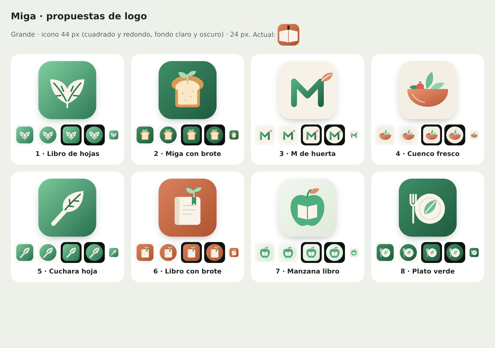
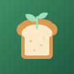
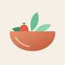

# Miga · logo proposals

| | File | Idea |
| :--- | :--- | :--- |
|  | `01-libro-hojas.svg` | An open book whose pages are two leaves |
|  | `02-miga-brote.svg` | A slice of bread ("miga") with a sprout |
|  | `03-m-huerta.svg` | An "M" drawn as stems, with a leaf |
|  | `04-cuenco.svg` | A bowl with fresh leaves and a tomato |
|  | `05-cuchara-hoja.svg` | A spoon whose bowl is a leaf |
|  | `06-libro-brote.svg` | The current book, closed, with a sprouting bookmark |
|  | `07-manzana-libro.svg` | An apple with an open book in it |
|  | `08-plato.svg` | A plate with a fork and a leaf |

All are 108×108 vector SVGs (Android adaptive icon size) in the app's "Huerta" colours.
