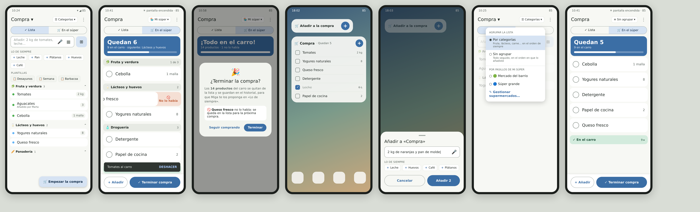

# Shopping list mockups (1.1.2)

1. **Lista**: prepare the list (quick add, usual items, templates, grouped by aisle).
2. **En el súper**: big rows, tap to tick, aisles in store order, counter, swipe for "No lo había", undo.
3. **Terminar compra**: clears the cart, keeps missing items.
4. **Widgets**: 2×1 quick add and resizable list with checkboxes.
5. **Añadir rápido**: sheet over the home screen, without opening the app.
6. **Agrupar**: by categories (default), ungrouped (order added) or by the aisles of a saved supermarket.
7. **En el súper, sin agrupar**.

Source: `mockup.html` (rendered with Playwright).

