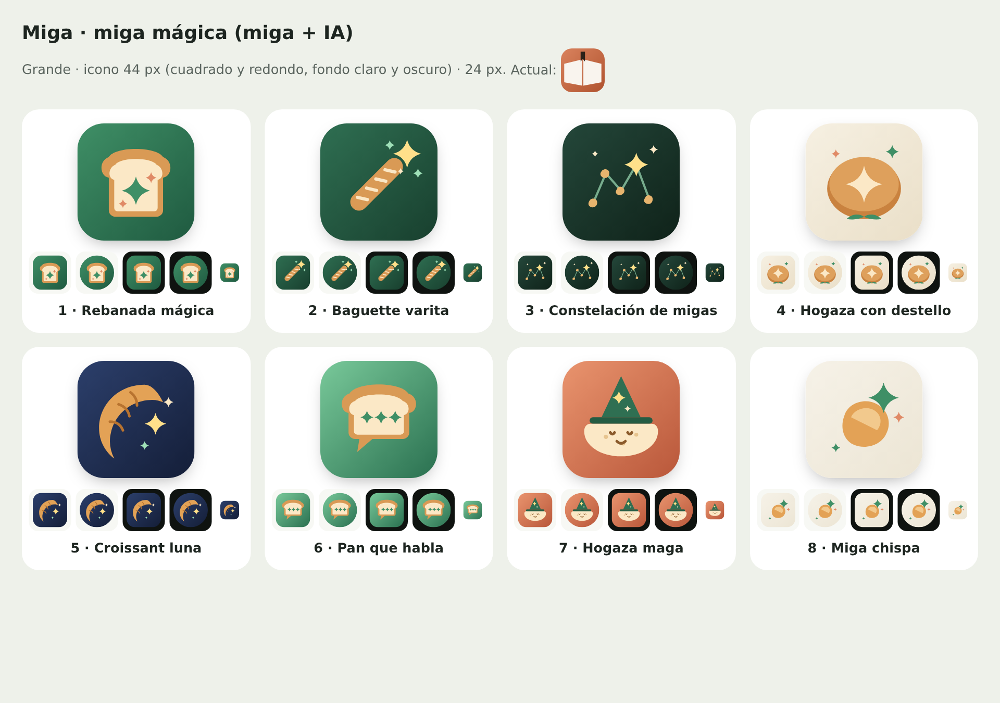
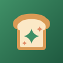

# Miga · "magic crumb" logo proposals (miga + AI)

| | File | Idea |
| :--- | :--- | :--- |
|  | `m1-rebanada-magica.svg` | A slice of bread with the AI sparkle in its crumb |
|  | `m2-baguette-varita.svg` | A baguette as a magic wand |
|  | `m3-constelacion.svg` | Crumbs joined like a constellation that draws an "M" |
|  | `m4-hogaza-destello.svg` | A round loaf whose score is a sparkle |
|  | `m5-croissant-luna.svg` | A croissant as a crescent moon, with stars |
|  | `m6-bocadillo-chat.svg` | A chat bubble shaped like a slice of bread (the assistant) |
|  | `m7-hogaza-maga.svg` | A smiling loaf in a wizard's hat |
|  | `m8-miga-chispa.svg` | A single crumb that sparkles (minimal) |
